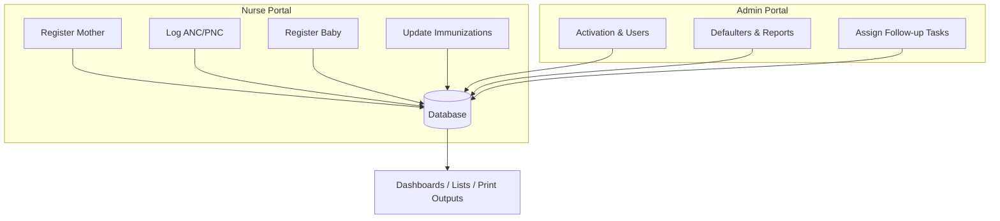
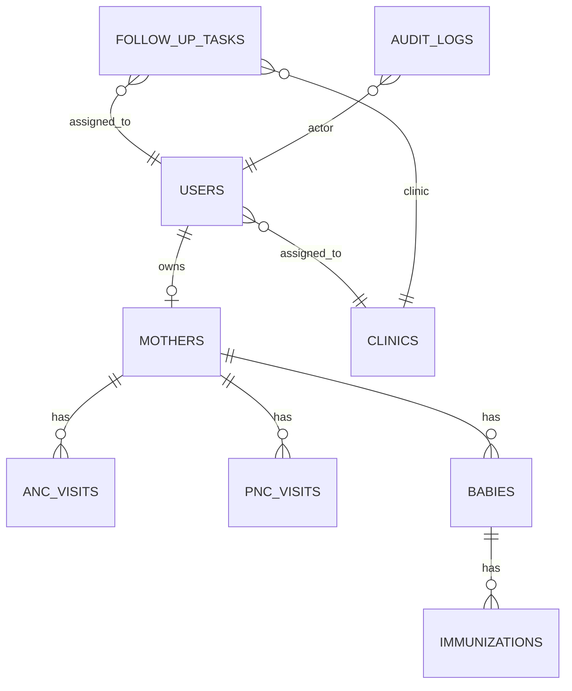

# Maternal and Child Health Tracking System (MCHTS)
## Mt Darwin District (27 Clinics) - Industrial Attachment Project Report

**Project type:** Web-based information system (clinical operations support).  
**Deployment:** Local XAMPP (Apache + PHP + MariaDB/MySQL) for pilot/demo; designed to scale to district roll-out.  
**Primary users:** Super/District Admin, Clinic/Clinical Admin, Nurse/Midwife, Mother (self-service where enabled).

**Institution:** Chinhoyi University of Technology (CUT)  
**Host organization:** Mt Darwin District Hospital  
**Project timeline:** January 2026 - 14 February 2026 (about 4 weeks)

---

# CHAPTER 1: INTRODUCTION
## 1.1 Introduction
Maternal and Child Health (MCH) services require accurate tracking of **ANC (Antenatal Care)**, **PNC (Postnatal Care)**, and **EPI immunizations**. In many districts, records are managed using paper registers and hand‑held cards. This creates operational problems such as slow record retrieval, missed follow-ups, weak defaulter tracing, and limited district oversight.

MCHTS digitizes core MCH workflows for **Mt Darwin District** and its **27 clinics**, while enforcing **role-based access** and **clinic scoping** to protect patient privacy.

## 1.1.1 Background
The district clinic workflow includes:
- Booking a pregnancy and scheduling ANC visits
- Logging ANC/PNC visits and clinical notes
- Recording delivery, registering babies, and following the child immunization schedule
- Identifying and following up ANC and immunization defaulters
- Managing clinic-to-clinic transfers

This project emphasizes **clinical usefulness**: defaulters lists + follow-up tasks + audit logs (accountability), not only data entry.

## 1.1.2 Company Organogram (Simplified)
This project is modeled for a district health environment:
- District Medical Officer / Superintendent
  - District Health Information Officer (DHIO)
  - Matron / Nursing Services Manager
    - Clinic/Clinical Admin (per clinic)
      - Nurses / Midwives
        - Village/Community Health Worker (community follow-up support)
          - Mothers / Caregivers

## 1.1.3 Vision
To improve maternal and child health outcomes through reliable digital records, proactive follow-up, and better decision-making at clinic and district level.

## 1.1.4 Mission Statement
To provide a secure, clinic-friendly system that supports ANC/PNC and EPI immunizations, strengthens defaulter tracing, and enables supervision across multiple facilities.

## 1.2 System Request Summary
The requested solution must:
- Track mothers (ANC/PNC) and babies (EPI schedule)
- Support 27 clinics with district vs clinic scope controls
- Provide operational lists (defaulters) and reporting
- Protect data using role-based security, audit logging, and safe handling of sensitive fields
- Work well for local demo constraints (mobile-friendly UI; offline indicator)

## 1.3 Problem Definition
Key problems to solve:
- **Fragmented records** (paper cards, registers, and separate clinic files)
- **Slow retrieval** and delays during visits
- **Weak defaulter monitoring** (inconsistent manual calculations)
- **Transfer tracking gaps** when clients move between clinics
- **Limited accountability** (who changed what, and why)
- **Privacy risks** (shared access, cross-clinic exposure)

## 1.4 Aim
To design and implement a district-ready MCH tracking system for Mt Darwin District that improves follow-up, supervision, and accountability across 27 clinics.

## 1.5 Objectives (SMART)
1. Digitize mother registration and assign unique clinic-aware identifiers (hospital number) **within the project period**.
2. Automatically generate ANC schedules (visits 1–8) at booking time for all pregnant mothers.
3. Register babies linked to mothers and automatically create the Zimbabwe EPI immunization schedule for each baby.
4. Provide defaulters lists (ANC and immunization) that can be viewed and printed **on demand**.
5. Improve accountability with audit logs for critical actions (overrides, safeguarding flags, task completion).
6. Apply privacy controls using role-based access, clinic scoping, and optional field-level encryption for selected sensitive fields.
7. Provide a responsive UI and offline indicator suitable for phone demos on local networks.

## 1.6 Constraints
- Power/internet interruptions (ZESA + connectivity)
- Budget constraints for SMS gateways/automation
- Localhost/LAN demonstration environment
- Mixed digital literacy (need for simple UI)

## 1.7 Justification
MCHTS provides:
- A single source of truth (records remain available even if cards are lost)
- Faster retrieval and continuity of care
- Proactive follow-up through defaulters lists and internal tasks (no SMS cost)
- Stronger accountability (audit trail)
- District reporting capability to compare clinic performance

## 1.8 Conclusion
This chapter outlined the background, problem, objectives, and constraints of the project.

---

# CHAPTER 2: PLANNING
## 2.0 Introduction
Planning covers business value, feasibility, risk, and a practical project schedule.

## 2.1 Business Value
- Reduced service delays via faster record retrieval
- Improved follow-up via schedules, defaulters lists, and follow-up tasks
- Better supervision via clinic comparisons and district dashboards
- Improved accountability and data quality through audit logging and validation

## 2.2 Feasibility Study
### 2.2.1 Technical Feasibility
Feasible within attachment constraints using:
- PHP + PDO + MariaDB/MySQL (XAMPP)
- Tailwind CSS (offline-ready `assets/output.css`)
- Service worker caching for static assets and offline fallback page (`public/sw.js`)

### 2.2.2 Operational Feasibility
Workflows match clinic processes:
- Booking and visit logging by nurses
- Activation, supervision, defaulters oversight by admins
- Clinic scoping prevents cross-clinic exposure

### 2.2.3 Economic Feasibility
No paid infrastructure is required for core functionality:
- Follow-up tasks provide accountability without SMS automation costs
- Print/PDF export supports community follow-up workflows

SMS gateways and AI decision support remain as roadmap items (future work).

## 2.3 Risk Analysis
| Risk | Impact | Mitigation in MCHTS |
|---|---:|---|
| Power/internet outage | High | Offline indicator + static caching + print exports |
| Data privacy breach | High | Role + clinic scoping + audit logs + optional encryption |
| Incorrect DOB/EDD entry | Medium | Validation + safeguarding flag workflow + audit reasons |
| Duplicate registration | Medium | Duplicate checks + search tools + unique identifiers |
| Password sharing / staff turnover | Medium | Admin reset flow + forced password change |

## 2.4 Project Plan
### 2.4.1 Project Schedule (Jan-Feb 2026)
| Phase | Deliverables | Timeline |
|---|---|---|
| Requirements | Problem statement, roles, workflows | Week 1 |
| Analysis | Current system weaknesses + requirements | Week 1 |
| Design | ERD/DFD + UI + security design | Week 2 |
| Implementation | Core modules + security controls | Weeks 2–3 |
| Testing | Unit + modular + acceptance testing | Week 4 |
| Documentation | User manual + final attachment report | Week 4 |

### 2.4.2 Gantt Chart (Text)
| Week | Dates (2026) | Activities |
|---:|---|---|
| 1 | January (Week 1) | Requirements + analysis |
| 2 | January (Week 2) | Design (DB + UI + security plan) |
| 3 | January/February (Week 3) | Implementation (core modules) |
| 4 | February (Week 4) | Testing + documentation + presentation preparation |

---
# CHAPTER 3: ANALYSIS
## 3.0 Introduction
This chapter analyses the existing workflow and specifies requirements for the proposed system.

## 3.1 Information Gathering Methodologies
- Interviews with nurses and clinic staff
- Observation of register/card-based processes
- Review of clinic forms and schedules (ANC + EPI)
- Supervisor feedback on required deliverables

## 3.2 Analysis of the Existing System
Common issues in the existing approach:
- Manual defaulter identification is inconsistent across clinics
- Records can be lost, duplicated, or incomplete
- District supervisors struggle to compare clinics using the same indicators
- Accountability is limited (no reliable audit trail)

## 3.3 Process Analysis (Key Processes)
- Nurse books mother → ANC schedule created
- Nurse logs ANC/PNC → progress recorded
- Nurse logs delivery → baby registration → immunization schedule created
- Admin supervises defaulters → assigns tasks → nurse completes follow-up

## 3.4 Data Analysis
### 3.4.1 Context Diagram
```mermaid
flowchart LR
  Mother((Mother)) -->|Self-service (optional)| MCHTS[MCHTS]
  Nurse((Nurse)) -->|Booking / Visits / Babies / Immunizations| MCHTS
  Admin((Admin)) -->|Users / Defaulters / Reports / Audits| MCHTS
  MCHTS -->|Dashboards / Lists / Print| Nurse
  MCHTS -->|Dashboards / Clinic comparisons| Admin
```

### 3.4.2 Data-Flow Diagram (Level 1)


## 3.5 Weaknesses in the Current System
- Poor follow-up visibility and inconsistent defaulter lists
- Lost hand-held cards reduce continuity of care
- Transfer tracking is weak across clinics
- Limited accountability for exceptions and overrides

## 3.6 Evaluation of Alternatives
| Alternative | Advantages | Disadvantages |
|---|---|---|
| Paper-only registers | Familiar, no tech setup | Weak reporting, errors, slow retrieval |
| Spreadsheets | Easy to start | Weak security, poor multi-user control |
| Full national integration | Best long-term | Not feasible within attachment constraints |
| **MCHTS (proposed)** | Balanced, secure, scalable | Requires basic local server setup |

## 3.7 Requirements Analysis
### 3.7.1 Functional Requirements
- Role-based authentication and redirects
- Clinic scoping (nurses/clinic admins limited to their clinic)
- Mother booking + ANC scheduling
- Delivery + baby registration + EPI immunization schedule generation
- Defaulters lists and follow-up tasks
- Transfers workflow
- Audit logging and safeguarding workflow (flag + acknowledge)

### 3.7.2 Non-Functional Requirements
- Security (hashing, CSRF, audits, optional encryption)
- Usability (responsive UI, simple workflows)
- Performance (pagination, limited list sizes)
- Availability (offline indicator; static caching)
- Maintainability (config modules: scope/crypto/audit/epi)

---

# CHAPTER 4: DESIGN
## 4.0 Introduction
This chapter presents the architecture, database design, and key algorithm designs.

## 4.1 System Design
**Architecture:** 3-tier design
1. Presentation: HTML + Tailwind CSS
2. Application: PHP (business rules, validation, security checks)
3. Data: MariaDB/MySQL

## 4.2 Architectural Design (Folder Structure)
- `auth/` — login and account flows
- `admin_portal/` — supervision and reporting
- `nurse_portal/` — clinic workflows
- `mother_portal/` — patient-facing self-service (where enabled)
- `config/` — reusable logic (auth, scoping, audit, crypto, epi)
- `includes/` — shared header/sidebar/footer UI

## 4.3 Physical Design (Environment Highlights)
- Windows + XAMPP (Apache, PHP, MariaDB/MySQL)
- Local network access for mobile demos (phone on same Wi‑Fi)

## 4.4 Database Design
### 4.4.1 ER Diagram (Core Entities)


### 4.4.2 Data Dictionary (Key Tables)
| Table | Purpose | Key fields |
|---|---|---|
| `users` | Accounts | `id, full_name, role, clinic_id, password_hash` |
| `clinics` | Clinics/facilities | `id, clinic_name, clinic_code` |
| `mothers` | Mother profile | `id, user_id, hospital_number, dob, edd, pregnancy_status, high_risk` |
| `anc_visits` | ANC schedule/log | `id, mother_id, visit_number, visit_date, next_visit_date, status` |
| `babies` | Baby profile | `id, mother_id, dob, gender, card_uid` |
| `immunizations` | EPI schedule | `id, baby_id, vaccine, due_date, status` |
| `deliveries` | Delivery record | `id, mother_id, delivery_date, delivery_type, outcome, complications` |
| `follow_up_tasks` | Internal tasks | `id, clinic_id, task_type, subject_type, assigned_to, status` |
| `audit_logs` | Audit trail | `id, user_id, action, module, description, created_at` |

## 4.5 Algorithm Design (Pseudocode)
### 4.5.1 ANC Schedule Generation
```
On booking a pregnant mother:
  if ANC visits do not exist:
    for i from 1 to 8:
      visit_date = start_date + (i-1)*28 days
      next_visit_date = visit_date + 28 days
      insert visit with status=PENDING and notes='Scheduled automatically'
```

### 4.5.2 Zimbabwe EPI Schedule Generation
```
On baby registration:
  for each vaccine schedule item:
    due_date = baby_dob + item.days
    if not already in DB:
      insert immunization row (PENDING)
```

### 4.5.3 Safeguarding Flag Workflow
```
Compute age from DOB:
  if age < 9: stop and request DOB correction
  if age <= 12: allow save + safeguarding_flag=1 (URGENT)
  if age 13..17: allow save + safeguarding_flag=1 (MINOR)
In mother history:
  show mandatory acknowledgement prompt until acknowledged
```

### 4.5.4 Delivery Method vs Birth Outcome (MoHCC-aligned)
```
When logging a delivery:
  delivery_type = how baby was delivered (Vaginal/SVD, C-Section, Vacuum, Breech, Forceps, Other)
  outcome = state at birth (Live Birth, Fresh Stillbirth, Macerated Stillbirth, etc.)
Store both values separately so district reporting can analyse intrapartum vs antenatal problems.
```

## 4.6 Interface Design
- Mobile-friendly layouts and readable cards
- Clear navigation per role
- Print/PDF-friendly views for defaulters and tasks

## 4.7 Security Design (Summary)
- Password hashing (`password_hash()`)
- CSRF tokens for sensitive POST actions
- Audit logging for accountability
- Clinic scoping to prevent cross-clinic access
- Optional field-level encryption (`config/crypto.php`) with `MCH_CRYPTO_KEY` in `config/db.php`

---

# CHAPTER 5: IMPLEMENTATION
## 5.1 Coding (Key Areas)
Important implementation files:
- Login: `auth/login.php`
- Nurse booking: `nurse_portal/register_mother.php`
- Mother clinical history: `nurse_portal/mother_history.php`
- Baby health record: `nurse_portal/baby_history.php`
- EPI schedule logic: `config/epi.php`
- Defaulters + printing: `admin_portal/anc_defaulters.php`, `admin_portal/immunization_defaulters.php`
- Follow-up tasks: `sql/follow_up_tasks.sql`, `nurse_portal/tasks.php`
- Security: `config/audit.php`, `config/csrf.php`, `config/crypto.php`, `config/scope.php`
- PWA basics: `public/sw.js`, `public/manifest.json`

## 5.2 Testing
### 5.2.1 Unit Testing
- PHP syntax checks: `php -l <file>`

### 5.2.2 Modular Testing
- Auth + role redirects
- Clinic scoping enforcement
- Booking + schedules + immunizations creation
- Defaulters pages match expected overdue logic
- Tasks assignment and completion
- Audit log entries created for key actions

### 5.2.3 Acceptance Testing
The live walkthrough sequence is documented in `docs/demo_script.md`.

## 5.3 Installation (Pilot/Demo)
### 5.3.1 Hardware Installation
- Laptop/desktop for XAMPP; optional phone testing via LAN.

### 5.3.2 Software Installation
- XAMPP (Apache, PHP, MariaDB/MySQL)
- Optional Node.js only if rebuilding Tailwind.

### 5.3.3 Database Installation
- Create DB `mch_system`
- Run required SQL scripts in `sql/`

### 5.3.4 Application Installation
- Place project under `htdocs/mch_system`
- Configure `config/db.php`

### 5.3.5 Training
- Admin/Nurse/Mother quick guide: `docs/user_manual.md`

### 5.3.6 Back-up
- Use phpMyAdmin export (SQL dump)

---

# CHAPTER 6: SYSTEM EVALUATION / ASSESSMENT
## 6.1 Strengths
- District vs clinic scoping supports 27-clinic operations
- Defaulters + internal tasks provide proactive follow-up without SMS cost
- Audit logs support accountability
- Safeguarding workflow improves handling of vulnerable cases

## 6.2 Limitations
- Full offline data entry + sync is future work (current: offline indicator + static caching)
- SMS automation requires a paid gateway (kept as roadmap)
- National interoperability (e.g., DHIS2) not implemented in this prototype

---

# CHAPTER 7: CONCLUSION
MCHTS provides a practical, scalable district-ready prototype for Mt Darwin District by digitizing ANC/PNC and child immunizations, strengthening follow-up and accountability, and protecting privacy through clinic scoping and security controls.

---

# APPENDICES
## Appendix A — Demo Walkthrough
- `docs/demo_script.md`

## Appendix B — User Manual
- `docs/user_manual.md`

## Appendix C — Deployment/Security Notes
- `docs/deployment_security.md`

## Appendix D — Readiness Checklist
- `docs/final_readiness_checklist.md`

## Appendix E — Key SQL Scripts
- `sql/follow_up_tasks.sql`
- `sql/audit_logs.sql`
- `sql/mothers_additional_risk_factors_migrate.sql`
- `sql/mothers_safeguarding_migrate.sql`
- `sql/deliveries_outcomes_migrate.sql`
- `sql/baby_bio_sensitive_encrypt_migrate.sql`

